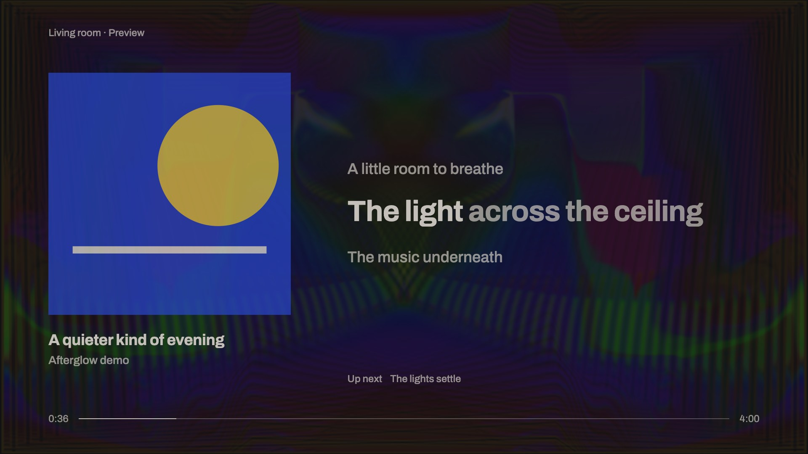
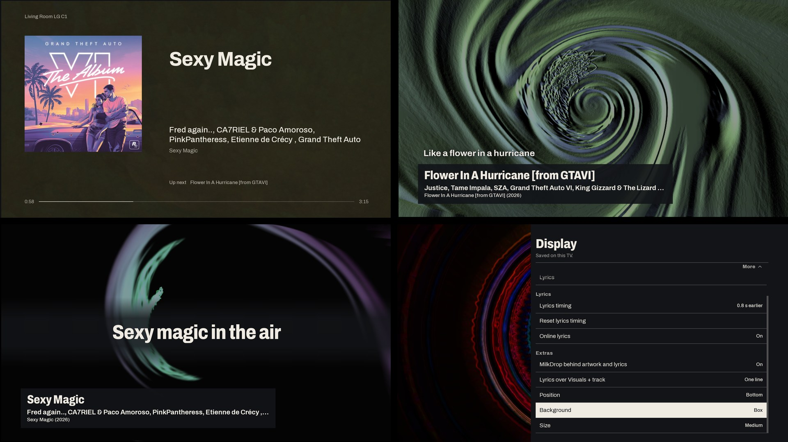
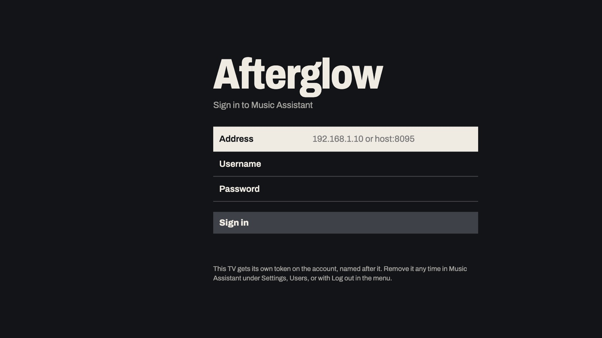
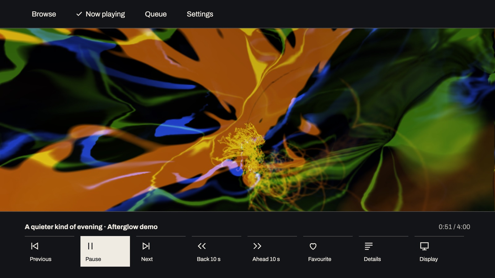

<p align="center">
  <picture>
    <source media="(prefers-color-scheme: dark)" srcset="docs/brand/afterglow-wordmark-paper.svg">
    
  </picture>
</p>

<p align="center">
  
</p>

# Afterglow

An unofficial Music Assistant player for LG webOS TVs. It shows the artwork, word-by-word lyrics and the queue, lets
you browse and play from the remote, and draws MilkDrop visuals in time with whatever your speakers are playing.

**[Try the demo in a browser →](https://haydengriffin.github.io/afterglow/)** It runs on made-up data. Use the arrow
keys and Enter as the remote's arrows and OK, and Escape as Back; OK → Display switches between Visuals, Album and
Lyrics.

Afterglow is independent of, and not endorsed by, Music Assistant or LG. It began as a fork of
[Michael Nestrud's viz-man](https://github.com/mnestrud/viz-man).

## What it does

- **Album, Lyrics and Visuals views.** Album shows the complete artwork with
  the song, artist and up next. Lyrics adds timed lyrics with the current line
  leading, word-by-word karaoke when the lyrics carry word timing, and paged
  plain lyrics otherwise. Visuals is MilkDrop on its own or with a track card;
  MilkDrop can also run behind the artwork and lyrics, or stop entirely.
- **Lyrics from Music Assistant, with an online fallback.** When Music
  Assistant has none, the TV looks the song up on [LRCLIB](https://lrclib.net)
  itself (see [Privacy](#privacy)). A per-TV **Lyrics timing** control moves
  the words up to 10 s earlier or later, and **Retry lyrics** asks again.
- **Browse and Search.** Recently played, favourite playlists, albums, songs
  and artists, radio stations, all playlists and albums, and search with the
  TV keyboard or voice. Play now, play next, add to the queue or start radio.
- **Queue.** Play, move and remove upcoming songs; shuffle, repeat,
  crossfade, keep playing when the queue ends, volume and sleep timer.
  **Playing on** picks the speaker; picking a silent one moves the music
  there (**Play on this TV** brings it to the TV). **Speakers together** joins
  or leaves a sync group.
- **Idle poster.** With nothing playing, the paused song or recent music is
  set as a poster, one OK away from playing.
- **Presets.** 395 MilkDrop presets (through Music Assistant's fork of
  Butterchurn), driven by the waveform Music Assistant streams a few seconds
  ahead, so the picture lands on the beat. **Scan presets** measures each one
  on your TV and keeps a list of the ones it runs smoothly. Presets can take
  their colours from the artwork, and a preset can be locked to an album or
  artist. Favourites are shared with Music Assistant's own MilkDrop favourites
  and between your TVs.
- **Remote keys.** Play/pause, Stop (pauses), fast-forward and rewind (next
  and previous track), plus the colour keys; see
  [Settings and remote keys](docs/settings.md).
- **Play on this TV.** Optionally the TV is a Music Assistant speaker through
  Sendspin, so one app both sounds and draws.
- **Kind to OLEDs.** Holds the screensaver off only while music plays and
  drifts the picture against burn-in.



## Requirements

- An LG webOS TV with WebGL2 (2020 models onward, webOS 5 or later; tested on
  an LG OLED C1, webOS 6), either rooted with the
  [Homebrew Channel](https://github.com/webosbrew/webos-homebrew-channel) or in
  Developer Mode.
- [Music Assistant](https://music-assistant.io/) 2.10 or newer on the same
  network, with the **MilkDrop Visualizer** plugin added (Settings →
  Plugins): it streams the waveform the visuals are drawn from.
- For the visuals, speakers Music Assistant streams to itself (Sonos,
  Chromecast, AirPlay, Squeezelite, ...). A speaker playing on its own, such as
  Spotify straight from the Spotify app, carries nothing to draw.

> **Status:** Afterglow runs every day on a rooted 2021 LG C1 (webOS 6). The Homebrew Channel listing and installs on
> other TVs and webOS versions haven't been tried yet. Long sessions on the C1 have shown native memory growing in an
> aged web runtime, which is under investigation (see [Performance](docs/performance.md)). Reports either way are very
> welcome.

## Install

Download `io.github.haydengriffin.afterglow_<version>_all.ipk` from the
[releases](https://github.com/HaydenGriffin/afterglow/releases), or build it
(below). Then either:

- **Homebrew Channel** (rooted TV): install the `.ipk` from a URL. From a
  checkout, `npm run serve-ipk` serves `dist/` and prints the URL to enter.
- **Developer Mode**: `npx ares-install --device <name> dist/io.github.haydengriffin.afterglow_<version>_all.ipk`.

Open Afterglow and sign in with your Music Assistant address, username and
password. The TV keeps its own long-lived token, named after the TV, which you
can revoke in Music Assistant or with **Log out**; the password is not stored.
Then run **Scan presets** once. The [setup guide](docs/install.md) walks
through every step.



## Settings

Press **OK** for the playback controls: a transport row with **Display** and
**Details**, and a top strip with **Browse**, **Now playing**, **Queue** and
**Settings** (sound and sync, display, presets, performance, account).
Per-TV settings live on the TV; favourites and shared preferences sync through
your Music Assistant account. See [Settings and remote keys](docs/settings.md),
[The preset scan](docs/preset-scan.md) and [Performance](docs/performance.md).



## Privacy

Afterglow talks to your Music Assistant server. Artwork comes through Music
Assistant's image proxy, falling back to the image's own address when the
proxy has none. The other exception is lyrics. They come from Music Assistant; when it has none for a
song, the TV asks [lrclib.net](https://lrclib.net) directly, sending the song's
title and artist (the album and length are only used on the TV to pick the
best match). LRCLIB sees the request coming from your network. Turn
**Online lyrics** off (OK → Display → Lyrics, shown in the Lyrics view) to
stop it; it is on by default and synced with your other TVs.

The TV stores its Music Assistant token in the app's own storage, never your
password. There is no analytics or telemetry. The browser demo requests nothing but its own files.

## Development

```sh
npm install
npm test
npm run package   # dist/io.github.haydengriffin.afterglow_<version>_all.ipk
                  # and dist/io.github.haydengriffin.afterglow.manifest.json
```

`npm run dev` serves the app in a desktop browser; `?mock=1` runs it on demo data without Music Assistant, which is
what the [browser demo](https://haydengriffin.github.io/afterglow/) is (built by
[`.github/workflows/pages.yml`](.github/workflows/pages.yml)). The README images are rendered from the demo by
[`scripts/showcase.mjs`](scripts/showcase.mjs) with Playwright. See [Development](docs/development.md) and the
[changelog](CHANGELOG.md).

## Support

Afterglow is free and open source. If it made your setup better, you can
[buy me a coffee](https://buymeacoffee.com/haydengriffin). Bug reports and
pull requests are just as welcome.

## Credits

- [viz-man](https://github.com/mnestrud/viz-man) by Michael Nestrud (MIT), the
  project Afterglow grew from.
- [Butterchurn](https://github.com/jberg/butterchurn) by Jordan Berg, in
  [Music Assistant's fork](https://github.com/music-assistant/butterchurn)
  (MIT), with the code its build inlines:
  [eel-wasm](https://github.com/captbaritone/eel-wasm) by Jordan Eldredge
  (MIT), [ecma-proposal-math-extensions](https://github.com/tc39/proposal-math-extensions)
  by Rick Waldron (MIT) and
  [@assemblyscript/loader](https://github.com/AssemblyScript/assemblyscript)
  (Apache-2.0).
- [butterchurn-presets](https://github.com/jberg/butterchurn-presets) (MIT),
  and the MilkDrop preset authors.
- [sendspin-js](https://github.com/Sendspin/sendspin-js) (Apache-2.0).
- [Archivo](https://github.com/Omnibus-Type/Archivo) typeface (SIL OFL 1.1).
- Lyrics fallback by [LRCLIB](https://lrclib.net).

Full notices are in [NOTICE](NOTICE) and [app/THIRD_PARTY.md](app/THIRD_PARTY.md).

## Licence

MIT, by Hayden Griffin. See [LICENSE](LICENSE).
